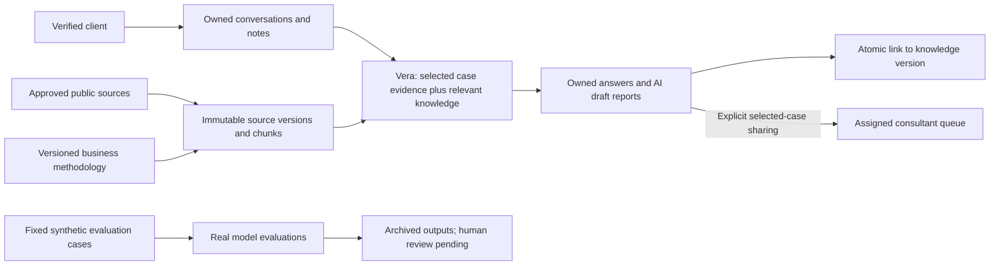

# Vera knowledge and evaluation storage

Candidate date: 16 November 2026. Apply the tested additive knowledge migration before publishing code that uses its RPC. Hosted application release remains separately gated.

Hosted status: migration `20261116210647_vera_knowledge_base.sql` is applied. Candidate application 05bec7a passed exact-head GitHub CI and Vercel preview `ErtAkwRo3FUVXMtqEPcnTEGQsoR8` is Ready. Main production still runs c014ce6. Later documentation/recovery and readable-calculation-label commits are tracked in the same draft PR #9.

## Data ownership

Private client evidence stays in the existing UUID-owned case ledger. Public legal texts and VANCORE-authored methods occupy a separate corpus. No conversation, case note, uploaded customer document or human client review is automatically promoted into shared knowledge. Search operates only on the selected approved source version, not across client cases.

## Tables in vancore_private

| Table | Purpose |
|---|---|
| vera_knowledge_sources | Migration-approved source registry, area, jurisdiction and fixed URL |
| vera_knowledge_versions | Immutable full retrieved text/HTML, SHA-256, database-generated MD5, timestamp and unreviewed/internal-methodology status |
| vera_knowledge_chunks | Versioned provisions/sections, ordinal and indexed full-text representation |
| vera_knowledge_checks | Append-only retrieval success/failure observations; no private query or upstream response body |
| vera_request_knowledge | Atomic link from a completed owned turn to the versions actually used |
| vera_evaluation_scenarios | Fixed, versioned synthetic dialogue/business/legal cases and explicit rubrics |
| vera_evaluation_runs | Append-only actual output/model, mechanical checks, knowledge references and pending human review |
| vera_evaluation_leases | Short per-administrator, scenario-bound single-flight reservation |

All eight tables have RLS and no browser grants. Service access is limited to required SELECT/INSERT; only ephemeral evaluation leases can be updated/deleted. Public SECURITY INVOKER RPCs grant EXECUTE only to service_role. The old casework function moves into the private schema and remains behind the new wrapper; the registered-account guard is preserved.

## Runtime

Business chat/report generation reads the versioned methodology. Numerical chat/report objects validate cited inputs, units and supported arithmetic. Legal research retrieves only fixed approved official URLs, verifies title/provision structure, archives the full accepted document, then asks the database to select relevant sections within that exact immutable version. Generated quotes must match selected text. Content digests and source/version references remain in the report. A source outage or archive failure produces a limited uncharged response; no stale legal version is silently represented as freshly verified law.

On successful finish, answer/charge and knowledge links commit in one transaction. Bad references abort without charge. A completed retry cannot append different provenance. Existing historical answers without knowledge references remain readable and are not retroactively relabelled.

An authenticated protected-role administrator can run one of six fixed synthetic cases through `/api/adminv2/vera-evaluations`. It accepts no custom prompt, history, customer ID or actor supplied by the browser. It has a scenario-bound two-minute lease and six-completed-runs-per-five-minutes limit. Results are appended to the database without client ledger usage. The Admin Dashboard's Vera section lists the last ten outputs. These mechanical observations are not professional approval or model training.

## Coverage and review

Initial shared corpus: VANCORE internal business methodology plus a registry for three Bulgarian acts, GDPR and Consumer Rights Directive. The registry alone is not ingested legal content; an accepted source must actually be fetched, stored and selected. Metadata unreviewed is never promoted to lawyer-approved by a generic consultant review. Worldwide coverage, all amendments, case law reconciliation, historical versions and reviewer qualification verification remain separate requirements.

The fixed Ministry sources and canonical EUR-Lex GDPR source were actually retrieved using the operating system’s TLS-verifying HTTP client. The stored corpus now has five versions and 1,742 chunks: internal method (1), Obligations and Contracts Act (287), Commerce Act (988), Labour Code (367), and GDPR (99). Legal versions remain **unreviewed**. The Consumer Rights Directive remains a registry entry without accepted content; its website transport challenge is not bypassed. Node runtime transport and legal force/currentness are not inferred from successful operator ingestion.

Dialogue rules progress from greeting and a clear initial question through facts, corrections, a useful recommendation and optional report/handoff. Greetings and new topics do not inherit stale legal/numerical routing. The model remains the existing free provider; no automatic paid fallback or background messages are added.

## Verification and recovery

`ops/supabase/vera-knowledge.test.cjs` applies the actual migration and checks immutable source ingestion, exact-version retrieval, private grants, atomic charge/provenance, evaluation permissions/leases and both rollback scripts. `verify-vera-knowledge-rollback.sql` runs the hosted acceptance entirely under BEGIN/ROLLBACK; no fake public law, client turn or evaluation is retained.

`scripts/verify-vera-backup.cjs` restores all corpus tables along with existing cases/profiles when the export contains the knowledge keys. It removes migration seed rows only in the isolated restore database, restores original IDs/values, regenerates search/digest columns and reruns casework/knowledge ROLLBACK acceptance. This remains targeted application recovery; it does not restore managed Auth/session/Storage/OS/DNS infrastructure.

Hosted knowledge ROLLBACK PASS: eleven profiles retain fingerprint `62126c1b4909072b566f0ac37bd0077d`; no synthetic case, source or evaluation remains. Post-change private snapshot SHA `40cb9d92ca46d10c72f39716212a5331504b26cb64288f02ca8f1f485eed3bf4` restores all customer rows and new corpus/evaluation tables with exact values and matching source SHA-256 values; both ROLLBACK acceptance scripts pass on the restored database. The snapshot precedes real model evaluations and contains zero runs. Keep later actual evaluation runs in subsequent exports.

Recovery must preserve all new versions, case links and evaluation history. Do not overwrite newer data from the pre-change snapshot. The previous c014ce6 frontend remains compatible with the additive schema, but must not be used as a permanent substitute for source-grounded research after a knowledge release is accepted.

17 November: runtime first selects an explicitly dated preserved database version. SQL and adapter enforce a maximum age of 24 hours; a later failed source observation makes it unavailable. Empty relevant selections stay limited without marking the whole source down. Expired/missing versions require successful online retrieval, with no stale fallback. A refresh scheduler is not installed; availability beyond that window depends on runtime transport or operator refresh.

64 application and 24 isolated Postgres tests pass. Hosted fresh-retrieval acceptance passes under ROLLBACK. Migration 20261116221329 matches the hosted SQL. The five-version export restores with identical values/source hashes and all three rollback checks; SHA-256 dbaf10524759aa714b8682f2b2f42416ec972ba98562672ca3144feed8c6a407. Eleven profiles retain their fingerprint. Six fixed model evaluations have **not** yet run; mechanical tests do not establish conversational/professional quality.

### Bounded extraction correction (17 November)

Additional inspection found that slicing Bulgarian source HTML up to the next article included text outside the final article container. Extraction now balances nested div boundaries for each article and excludes external appendices/headings. A regression fixture covers this. Corrected plain-text LF source files and bounded chunks were ingested as new immutable versions; original versions remain archived. Latest five source versions contain 1,729 chunks (274 obligations, 988 commerce, 367 labour, 99 GDPR, 1 method); all history totals eight versions / 3,371 chunks. Live exact-version selection confirms the appendix is excluded. The earlier 1,742-count export remains a historical checkpoint, not the corrected final archive.
